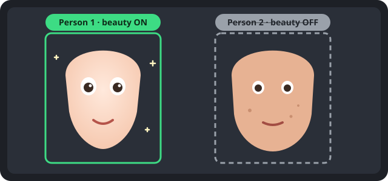

# xixi-beauty-cam

[](LICENSE)
[](https://github.com/hohshen/xixi-beauty-cam/actions/workflows/ci.yml)

English | [繁體中文](README.zh-TW.md)

**A beauty camera that runs entirely in your browser and lets you switch beauty off for individual people in the frame.** It separates two things most beauty cameras mix up: a **filter** is color grading for the whole picture, and **beauty** is retouching applied only to faces. xixi-beauty-cam tags every face ("Person 1", "Person 2", …); tap a tag to keep that person's face un-retouched while everyone else still gets beauty, and the whole frame still shares one filter.

<p align="center">
  
</p>

> **Status: early prototype (0.1.0).** The image pipeline and both preset formats are covered by automated tests, but the full UI has only been checked on desktop Chrome so far. See [Known limitations](docs/architecture.md#known-limitations).

## Quick start

No build step and no runtime dependencies — it is a static web page.

```sh
git clone https://github.com/hohshen/xixi-beauty-cam.git
cd xixi-beauty-cam
python3 -m http.server 8000 --directory app   # or: npm start
```

Open <http://localhost:8000/> in Chrome, press **開啟鏡頭** (Start camera) and allow camera access. `localhost` is a secure origin, so the camera API works without HTTPS. No camera, or only one person around? Use **用照片模擬鏡頭** (Use a photo as the camera) and pick a group photo.

> The interface is currently in Traditional Chinese. Contributions for other languages are welcome.

## Features

| Feature                      | What it does                                                                                                                                                                                                                                    |
| ---------------------------- | ----------------------------------------------------------------------------------------------------------------------------------------------------------------------------------------------------------------------------------------------- |
| **Filter tab (濾鏡)**        | Color grading for the **whole frame**: exposure, contrast, saturation, temperature, tint, fade, vignette, grain. Everyone and the background get it, including people with beauty off, so the photo keeps one tone.                             |
| **Beauty tab (美顏)**        | Face retouching for **faces only**: skin smoothing, whitening, slimming, eye enlarging. No color shift. Each tab has its own preset bar and intensity slider and remembers its last choice.                                                     |
| **Per-person beauty on/off** | Every detected face gets a label. Tap it to switch beauty off for that person; their face (and a protection zone around it) gets only the filter, pixel-identical to the filtered original, even when the person next to them is being slimmed. |
| **Make and share**           | Fine-tune under _Advanced_, save your own filter or beauty preset, export it as `.xixi-filter.json` or `.xixi-beauty.json`, and send it to anyone. Dropped files go to the right tab automatically.                                             |
| **Capture**                  | The shutter button saves the current frame as a PNG, with the filter and beauty effect but without labels or UI.                                                                                                                                |
| **Photo as camera**          | Feed a still photo through the exact same pipeline, for testing multi-person scenes without a crowd.                                                                                                                                            |
| **Diagnostics**              | Mask view, "beauty difference ×20" view (compares against the filter-only frame; people with beauty off are pure black), and an fps / per-stage timing panel.                                                                                   |

How it works, in one line: camera → [MediaPipe Face Landmarker](https://ai.google.dev/edge/mediapipe/solutions/vision/face_landmarker) → cross-frame tracking → per-person mask and warp parameters → one WebGL2 shader pass (beauty on beauty-on faces: warp, bilateral smoothing, brightening; then the filter's color grading over the whole frame) → canvas. Details in [docs/architecture.md](docs/architecture.md).

## Privacy

**Your camera image never leaves your device.** All detection and rendering happen in the browser tab. The page only requests files from its own origin: the MediaPipe library, its WASM and the Face Landmarker model are shipped in `app/vendor/` at pinned versions. A Content-Security-Policy (`connect-src 'self'`) stops the page from contacting any other host — this also blocks the usage-statistics logger built into MediaPipe 1.2.2 (see [app/vendor/README.md](app/vendor/README.md)). There is no analytics, telemetry, error reporting, account or upload. Captured photos are generated locally and only leave the page when you download or share them yourself. Filter and beauty preset files are read locally as data and never executed.

You can verify this yourself in DevTools → Network; the expected request list is in [docs/architecture.md](docs/architecture.md#network-requests).

## Browser support

| Browser                   | Status                                                                                                                              |
| ------------------------- | ----------------------------------------------------------------------------------------------------------------------------------- |
| Chrome / Edge (desktop)   | Developed and tested here                                                                                                           |
| Firefox, Safari (desktop) | Not verified yet                                                                                                                    |
| iPhone Safari (iOS 16.4+) | Supported in code (PWA, camera switch, share to Photos); not verified on a device yet — see [Testing on phones](#testing-on-phones) |
| Android Chrome            | Supported in code (PWA install, camera switch, share); not verified on a device yet — see [Testing on phones](#testing-on-phones)   |

Requirements: WebGL2, WebAssembly, ES modules, `getUserMedia` (served over `https://` or `localhost`).

## Install as an app and use offline

xixi-beauty-cam is a Progressive Web App. On the first visit a service worker stores the whole app, including MediaPipe and the model (about 19 MB), so later it opens and detects faces without a network connection.

- **iPhone / iPad (Safari):** Share button → _Add to Home Screen_.
- **Android (Chrome):** menu ⋮ → _Install app_ (or _Add to Home screen_).
- **Desktop Chrome / Edge:** the install icon in the address bar.

On phones the shutter shows a preview with **分享／存到照片** (opens the system share sheet; on iPhone choose _Save Image_ to put it in Photos) and **下載**. The ⟲ button next to the shutter switches between the front and rear camera. If the preview drops below 24 fps for 3 seconds, the app lowers its quality step by step (smoothing samples, then face detection every 2nd or 3rd frame); the current level is shown in the ⋯ menu's fps panel, where you can also pin a level.

To publish it, put the `app/` folder on any static host — see [docs/deploy.md](docs/deploy.md). For Cloudflare Pages there is a ready-made script: after a one-time setup, `deploy/cloudflare/deploy.sh` checks, tests and deploys in one command (see [deploy/cloudflare/README.md](deploy/cloudflare/README.md)).

## Make your own filter or beauty preset

Both are tiny JSON files. A filter (`*.xixi-filter.json`) holds eight color-grading numbers from −100 to 100; a beauty preset (`*.xixi-beauty.json`) holds four retouching numbers from 0 to 100. Make one in the app and export it, or write it by hand:

```json
{
  "format": "xixi-filter",
  "version": 1,
  "id": "soft-film",
  "name": "Soft film",
  "license": "CC0-1.0",
  "params": { "contrast": -5, "saturation": -10, "temperature": 8, "fade": 15, "vignette": 10, "grain": 5 }
}
```

```json
{
  "format": "xixi-beauty",
  "version": 1,
  "id": "soft-glow",
  "name": "Soft glow",
  "license": "CC0-1.0",
  "params": { "smooth": 60, "whiten": 30, "slim": 10, "eye": 5 }
}
```

Read the [filter and beauty preset guide](docs/filters.md) for the difference between the two, the full formats and how to propose a built-in.

## Testing on phones

Phones only allow the camera on `https://` pages or on `localhost`, so a page served from your computer's LAN address (`http://192.168.x.x:8000`) cannot open the camera. Use one of the setups below. Keep test photos and screenshots with faces off the repository. The offline check (step 4) is the acceptance test for the PWA.

### iPhone Safari

1. Serve `app/` over HTTPS on your LAN. One way: create a local certificate with [mkcert](https://github.com/FiloSottile/mkcert) (`mkcert -install && mkcert 192.168.x.x`), install and trust mkcert's root CA on the iPhone (Settings → General → About → Certificate Trust Settings), and serve `app/` with any HTTPS static server using that certificate. Alternatively, use a preview deployment (see [docs/deploy.md](docs/deploy.md)).
2. Open the page in Safari, tap **開啟鏡頭**, allow the camera. Expected: live mirrored preview in portrait, labels on faces, no full-screen video player.
3. Tap ⟲ next to the shutter. Expected: rear camera, not mirrored; tap again to return to the front camera.
4. **Offline:** wait for the message 「離線檔案已存好…」 (or wait 30 s), then turn on Airplane Mode, close the tab and open the page again. Expected: the page opens, **開啟鏡頭** works and faces are detected.
5. Share → _Add to Home Screen_, open it from the home screen. Expected: full screen without Safari UI, the notch and home indicator do not cover the menu, labels or shutter; still works in Airplane Mode.
6. Shutter → **分享／存到照片** → _Save Image_. Expected: the photo (with effect, without labels) is in Photos. **下載** saves it to Files.
7. Rotate to landscape and back. Expected: the controls move to the right side in landscape; the picture is not stretched; preview continues.
8. Switch to another app for a few seconds and come back. Expected: the preview resumes (the camera restarts if iOS released it).
9. Open ⋯ → watch the fps panel for 1 minute with 美顏 "網紅" and 濾鏡 "膠片". Note the fps and the 畫質 level; if fps stays under 24, the level should step down within a few seconds.
10. Scroll the preset bars, drag the intensity slider, tap a face label. Expected: no page zoom, no text selection, no pull-to-refresh.

### Android Chrome

1. Easiest: enable USB debugging, connect the phone, open `chrome://inspect/#devices` on the computer, add port forwarding `8000 → localhost:8000`, run `npm start`, and open `http://localhost:8000/` on the phone (`localhost` counts as secure). Alternatively use HTTPS on the LAN or a preview deployment as for iPhone.
2. Tap **開啟鏡頭**, allow the camera. Expected: live mirrored preview in portrait.
3. Tap ⟲. Expected: rear camera, not mirrored, and back.
4. **Offline:** wait for 「離線檔案已存好…」, then turn on Airplane Mode (or stop the server), reload. Expected: the page opens, **開啟鏡頭** works and faces are detected. In `chrome://inspect` DevTools → Application → Service workers shows `sw.js` activated, Cache storage shows `xixi-beauty-cam-…` with about 40 entries.
5. Menu ⋮ → _Install app_, open it from the launcher. Expected: standalone window with the app icon, starts in portrait.
6. Shutter → **分享／存到照片**. Expected: Android share sheet with the PNG (e.g. save to Google Photos or Files); **下載** saves to Downloads.
7. Rotate, background/foreground, fps panel and touch checks as steps 7–10 for iPhone.
8. DevTools → Network (with the remote inspector): every request goes to the page's own origin; the only blocked request is MediaPipe's statistics logger (`odml.pa.googleapis.com`, shown as a CSP error in the console).

## Contributing

Bug reports, ideas, new filters, beauty presets and code are all welcome. Start with [CONTRIBUTING.md](CONTRIBUTING.md) for the dev setup, tests and pull request flow. Please follow the [Code of Conduct](CODE_OF_CONDUCT.md). Report security issues privately as described in [SECURITY.md](SECURITY.md); for questions see [SUPPORT.md](SUPPORT.md).

```sh
npm ci          # dev tools only (ESLint, Prettier)
npm test        # unit tests + filter / beauty preset validation
npm run lint    # ESLint + Prettier check
```

## Third-party components

Shipped unmodified in [`app/vendor/`](app/vendor/README.md) (pinned versions, SHA-256 checked by `npm test`) and served from the app's own origin. See [NOTICE](NOTICE).

| Component                                                         | Version   | License                          | Source                                                                                                           |
| ----------------------------------------------------------------- | --------- | -------------------------------- | ---------------------------------------------------------------------------------------------------------------- |
| MediaPipe Tasks Vision (`@mediapipe/tasks-vision`), JS + WASM     | 1.2.2     | Apache-2.0                       | npm `@mediapipe/tasks-vision@1.2.2` (<https://www.npmjs.com/package/@mediapipe/tasks-vision/v/1.2.2>)            |
| Face Landmarker model `face_landmarker.task` (float16, version 1) | float16/1 | Apache-2.0 (per the model cards) | <https://storage.googleapis.com/mediapipe-models/face_landmarker/face_landmarker/float16/1/face_landmarker.task> |

## License

Code: [Apache License 2.0](LICENSE). Built-in filters in `app/filters/` and beauty presets in `app/beauty/` are released under CC0-1.0, as stated in each file.
