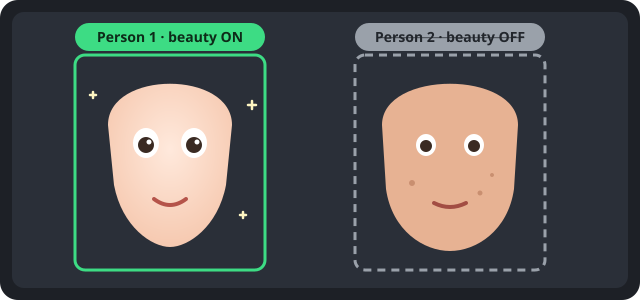

# xixi-beauty-cam

[](LICENSE)
[](https://github.com/hohshen/xixi-beauty-cam/actions/workflows/ci.yml)

[English](README.md) | 繁體中文

**在瀏覽器裡執行的美顏相機，可以針對畫面中的某個人關掉美顏。** 它把兩件事分開：**濾鏡**是整張照片的調色，**美顏**是只套在臉上的修飾。xixi-beauty-cam 會在每張臉上標「人物 1」「人物 2」……，點一下標籤，那個人的臉就不修飾，其他人照樣美顏，整張畫面仍套同一個濾鏡。

<p align="center">
  
</p>

> **狀態：早期原型（0.1.0）。** 影像管線與濾鏡、美顏兩種檔案格式有自動測試，完整介面目前只在桌面版 Chrome 確認過。見[已知限制](docs/architecture.md#known-limitations)。

## 快速開始

不需要建置，也沒有執行期相依，就是一個靜態網頁。

```sh
git clone https://github.com/hohshen/xixi-beauty-cam.git
cd xixi-beauty-cam
python3 -m http.server 8000 --directory app   # 或 npm start
```

用 Chrome 開 <http://localhost:8000/>，按「**開啟鏡頭**」並允許鏡頭權限。`localhost` 屬於安全來源，不用 HTTPS 也能開鏡頭。沒有鏡頭或身邊只有一個人時，按「**用照片模擬鏡頭**」選一張合照。

## 功能

| 功能               | 說明                                                                                                                             |
| ------------------ | -------------------------------------------------------------------------------------------------------------------------------- |
| **濾鏡分頁**       | 套在**整張畫面**的調色：曝光、對比、飽和、色溫、色調、褪色、暗角、顆粒。所有人和背景一起套，美顏關的人也一樣，整張照片色調一致。 |
| **美顏分頁**       | 只套在**臉上**的修飾：磨皮、美白、瘦臉、大眼，不做色調變化。兩個分頁各有自己的預設列與強度條，並各自記住上次的選擇。             |
| **逐人開關美顏**   | 每張偵測到的臉都有標籤，點一下就關掉那個人的美顏。被關掉的人臉部（含周圍保護區）只套濾鏡，與「只套濾鏡」的畫面逐像素相同。       |
| **自製與分享**     | 在「進階」微調後另存為自己的濾鏡或美顏，匯出成 `.xixi-filter.json` 或 `.xixi-beauty.json` 傳給別人；拖進頁面會自動放進對的分頁。 |
| **拍照**           | 快門把目前畫面存成 PNG，含濾鏡與美顏，不含標籤與介面。                                                                           |
| **用照片模擬鏡頭** | 讓一張照片走完全相同的流程，不用找一群人也能測多人畫面。                                                                         |
| **檢視與量測**     | 遮罩檢視、「美顏差異 ×20」（比對只套濾鏡的畫面，美顏關的人應全黑）、fps 與各階段耗時面板。                                       |

流程一句話：鏡頭 → [MediaPipe Face Landmarker](https://ai.google.dev/edge/mediapipe/solutions/vision/face_landmarker) → 跨幀追蹤 → 逐人遮罩與變形參數 → 一個 WebGL2 shader pass（先對美顏開的臉變形、雙邊濾波磨皮、提亮，再對整張畫面套濾鏡調色）→ canvas。細節見 [docs/architecture.md](docs/architecture.md)。

## 隱私

**鏡頭影像不會離開你的裝置。** 偵測與渲染都在瀏覽器分頁裡完成。頁面只向自己的網域要檔案：MediaPipe 函式庫、WASM 與 Face Landmarker 模型都以固定版本放在 `app/vendor/`。內容安全政策（CSP，`connect-src 'self'`）讓頁面連不到其他主機，也擋掉 MediaPipe 1.2.2 內建的使用統計（見 [app/vendor/README.md](app/vendor/README.md)）。沒有分析、遙測、錯誤回報、帳號或上傳。照片在本機產生，只有你自己按下載或分享才會離開頁面。濾鏡檔只在本機當資料讀取，不會被執行。

可以在 DevTools → Network 自己確認，應有的請求清單見 [docs/architecture.md](docs/architecture.md#network-requests)。

## 瀏覽器支援

| 瀏覽器                         | 狀態                                                                            |
| ------------------------------ | ------------------------------------------------------------------------------- |
| Chrome／Edge（桌面）           | 開發與測試環境                                                                  |
| Firefox、Safari（桌面）        | 尚未驗證                                                                        |
| iPhone Safari（iOS 16.4 以上） | 程式已支援（PWA、前後鏡頭、存到照片），尚未實機驗證，見[手機實測](#手機實測)    |
| Android Chrome                 | 程式已支援（安裝成 app、前後鏡頭、分享），尚未實機驗證，見[手機實測](#手機實測) |

需求：WebGL2、WebAssembly、ES modules、`getUserMedia`（需在 `https://` 或 `localhost` 下開啟）。

## 安裝成 app、離線使用

xixi-beauty-cam 是 PWA。第一次開啟時 service worker 會把整個 app（含 MediaPipe 與模型，約 19 MB）存起來，之後沒有網路也能開啟並偵測人臉。

- **iPhone／iPad（Safari）**：分享按鈕 →「加入主畫面」。
- **Android（Chrome）**：選單 ⋮ →「安裝應用程式」（或「加到主畫面」）。
- **桌面 Chrome／Edge**：網址列的安裝圖示。

手機上按快門會先顯示預覽，有「分享／存到照片」（開系統分享面板；iPhone 選「儲存影像」就存進相簿）與「下載」。快門右邊的 ⟲ 切換前後鏡頭。預覽連續 3 秒低於 24 fps 時會自動一級一級降低畫質（先減少磨皮取樣數，再改成每 2 或 3 幀偵測一次人臉），目前等級顯示在 ⋯ 選單的 fps 面板，也可以在那裡固定等級。

要上線就把 `app/` 資料夾放到任何靜態主機，見 [docs/deploy.md](docs/deploy.md)。以 Cloudflare Pages 為例：輸出資料夾設成 `app`、不需要建置指令，或直接上傳 `app/`。

## 自製濾鏡與美顏

兩種都是小 JSON 檔。濾鏡（`*.xixi-filter.json`）是八個 -100～100 的調色數字；美顏預設（`*.xixi-beauty.json`）是四個 0～100 的修飾數字。可以在 app 裡調好匯出，也可以手寫：

```json
{
  "format": "xixi-filter",
  "version": 1,
  "id": "soft-film",
  "name": "淡淡底片",
  "license": "CC0-1.0",
  "params": { "contrast": -5, "saturation": -10, "temperature": 8, "fade": 15, "vignette": 10, "grain": 5 }
}
```

```json
{
  "format": "xixi-beauty",
  "version": 1,
  "id": "soft-glow",
  "name": "柔光",
  "license": "CC0-1.0",
  "params": { "smooth": 60, "whiten": 30, "slim": 10, "eye": 5 }
}
```

兩者的差別、完整格式與「怎麼加進內建清單」見[濾鏡與美顏指南](docs/filters.zh-TW.md)。

## 手機實測

手機只允許 `https://` 或 `localhost` 的頁面使用鏡頭，用電腦區網位址（`http://192.168.x.x:8000`）開的頁面打不開鏡頭，所以用下面的方式。含人臉的測試照片與截圖不要放進 repo。第 4 步的離線檢查就是 PWA 的驗收。

### iPhone Safari

1. 在區網用 HTTPS 提供 `app/`。例如用 [mkcert](https://github.com/FiloSottile/mkcert) 建本機憑證（`mkcert -install && mkcert 192.168.x.x`），把 mkcert 的根憑證裝到 iPhone 並信任（設定 → 一般 → 關於本機 → 憑證信任設定），再用任何支援 HTTPS 的靜態伺服器提供 `app/`。也可以用預覽部署（見 [docs/deploy.md](docs/deploy.md)）。
2. 用 Safari 開啟，點「開啟鏡頭」並允許。預期：直式、鏡像的即時預覽，臉上有標籤，影片不會跳成全螢幕播放器。
3. 點快門旁的 ⟲。預期：換成後鏡頭、不鏡像；再點一次回到前鏡頭。
4. **離線**：等到出現「離線檔案已存好…」（或等 30 秒），開飛航模式，關掉分頁再重新開啟。預期：頁面能開，「開啟鏡頭」能用，也偵測得到人臉。
5. 分享 →「加入主畫面」，從主畫面開啟。預期：全螢幕、沒有 Safari 介面，瀏海與 Home 指示條不蓋住選單、標籤與快門；飛航模式下一樣能用。
6. 快門 →「分享／存到照片」→「儲存影像」。預期：照片（有效果、沒有標籤）出現在「照片」。「下載」會存到「檔案」。
7. 轉成橫式再轉回來。預期：橫式時操作區移到右側；畫面不變形；預覽不中斷。
8. 切到別的 app 幾秒再回來。預期：預覽恢復（iOS 收回鏡頭時會自動重開）。
9. 開 ⋯，美顏「網紅」、濾鏡「膠片」，看 fps 面板 1 分鐘。記下 fps 與「畫質」等級；fps 一直低於 24 時，幾秒內等級應該往下降。
10. 滑動預設列、拖強度滑桿、點臉上的標籤。預期：頁面不縮放、不選取文字、不會下拉重新整理。

### Android Chrome

1. 最簡單：開 USB 偵錯、接上電腦，在電腦開 `chrome://inspect/#devices`，加連接埠轉送 `8000 → localhost:8000`，執行 `npm start`，在手機開 `http://localhost:8000/`（`localhost` 算安全來源）。也可以像 iPhone 一樣用區網 HTTPS 或預覽部署。
2. 點「開啟鏡頭」並允許。預期：直式、鏡像的即時預覽。
3. 點 ⟲。預期：換成後鏡頭、不鏡像，再點回來。
4. **離線**：等到「離線檔案已存好…」，開飛航模式（或停掉伺服器），重新整理。預期：頁面能開，「開啟鏡頭」能用，也偵測得到人臉。在 `chrome://inspect` 的 DevTools → Application → Service workers 看到 `sw.js` 已啟用，Cache storage 有 `xixi-beauty-cam-…`，約 40 筆。
5. 選單 ⋮ →「安裝應用程式」，從桌面開啟。預期：獨立視窗、有 app 圖示、直式開啟。
6. 快門 →「分享／存到照片」。預期：Android 分享面板帶著 PNG（可存到 Google 相簿或檔案）；「下載」存到下載資料夾。
7. 轉向、切背景、fps 面板與觸控檢查同 iPhone 第 7–10 步。
8. 遠端 DevTools → Network：所有請求都是頁面自己的網域；唯一被擋的是 MediaPipe 的使用統計（`odml.pa.googleapis.com`，主控台顯示為 CSP 錯誤）。

## 參與貢獻

歡迎回報問題、提想法、貢獻濾鏡、美顏預設或程式。開發環境、測試與 PR 流程見 [CONTRIBUTING.md](CONTRIBUTING.md)，請遵守[行為準則](CODE_OF_CONDUCT.md)。資安問題請依 [SECURITY.md](SECURITY.md) 私下回報；使用問題見 [SUPPORT.md](SUPPORT.md)。

```sh
npm ci          # 只裝開發工具（ESLint、Prettier）
npm test        # 單元測試 + 濾鏡與美顏檔驗證
npm run lint    # ESLint + Prettier 檢查
```

## 第三方元件

原封不動放在 [`app/vendor/`](app/vendor/README.md)（固定版本，`npm test` 會檢查 SHA-256），由 app 自己的網域提供。見 [NOTICE](NOTICE)。

| 元件                                                           | 版本      | 授權                   | 來源                                                                                                             |
| -------------------------------------------------------------- | --------- | ---------------------- | ---------------------------------------------------------------------------------------------------------------- |
| MediaPipe Tasks Vision（`@mediapipe/tasks-vision`）JS 與 WASM  | 1.2.2     | Apache-2.0             | npm `@mediapipe/tasks-vision@1.2.2`（<https://www.npmjs.com/package/@mediapipe/tasks-vision/v/1.2.2>）           |
| Face Landmarker 模型 `face_landmarker.task`（float16，版本 1） | float16/1 | Apache-2.0（依模型卡） | <https://storage.googleapis.com/mediapipe-models/face_landmarker/face_landmarker/float16/1/face_landmarker.task> |

## 授權

程式碼：[Apache License 2.0](LICENSE)。`app/filters/` 的內建濾鏡與 `app/beauty/` 的內建美顏預設以 CC0-1.0 釋出（各檔內有註明）。
